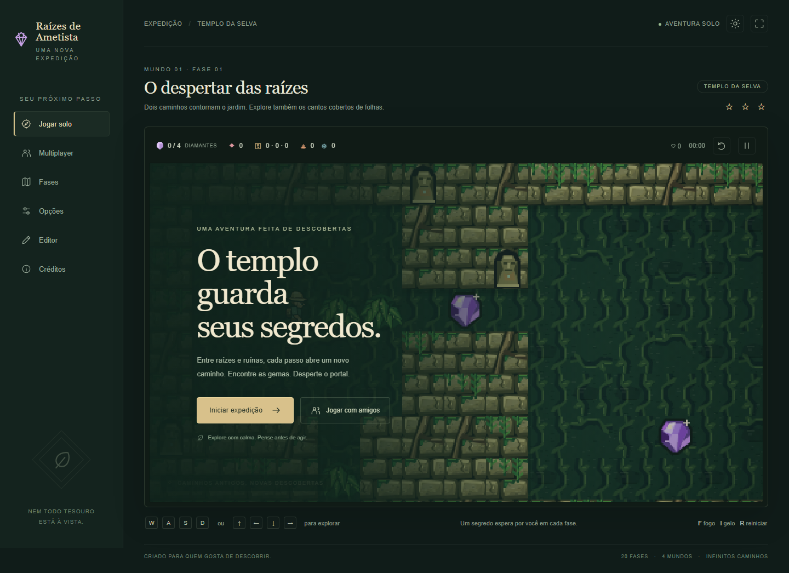

# Raízes de Ametista

Jogo original de puzzle e aventura em Canvas 2D, TypeScript e Vite, com servidor autoritativo Node.js + ws. Interface em português brasileiro.

## Arquitetura e plano

- `src/shared`: tipos, constantes e simulação pura. `step(state, intents)` produz um novo estado a cada 40 ms; nenhum DOM, relógio externo ou aleatoriedade entra nas regras. Movimento: 200 ms. Gravidade: 240 ms.
- `src/client`: renderizador Canvas com sprites procedurais originais, interpolação, câmera, áudio sintetizado e interface responsiva.
- `src/server`: HTTP e WebSocket no mesmo processo. Salas de 2 a 4 pessoas, inventário compartilhado no co-op e uma simulação independente por participante na corrida. O cliente transmite apenas intenções.
- `levels`: 20 arquivos JSON originais, quatro mundos com cinco fases. Circuitos e teleportes são declarativos.
- `scripts`: desenvolvimento, BFS com a mesma simulação e geração de conteúdo.
- `tests/game`: Vitest para regras e integração de rede; testes de navegador separados.

Marcos: M1 núcleo e testes; M2 renderização; M3 mecânicas; M4 multiplayer; M5 conteúdo, editor e solver; M6 interface e áudio; M7 documentação e empacotamento. Cada marco exige build, testes e validação reais antes do commit.

## Executar

Node.js 22.12+ (recomendado 24 LTS).

```sh
npm install
npm run dev
```

Abra o endereço impresso pelo Vite. `npm run dev` inicia também o servidor de salas em 3001 e encaminha `/ws` e `/api` pelo Vite. Para produção: `npm run build && npm start`, porta padrão 3001 (`PORT` configurável). O build web fica em `web-dist`.

## Fidelidade ao Diamond Rush

Mantidos: exploração em grade, ritmo deliberado, folhagem, pedras com gravidade e empurrões, diamantes, portas, armadilhas, checkpoints, poderes elementais e descoberta de segredos. A referência orienta a atmosfera de aventura em templo e a legibilidade dos tiles.

Alterados de propósito: nome, exploradores, paletas, desenho procedural, música sintetizada e todos os layouts. Co-op, corrida, editor e ranking são extensões originais. Nenhum asset ou layout do jogo de referência é distribuído.

Consulte `DECISIONS.md` para as escolhas de comportamento e `docs/PROGRESS.md` para a evidência de cada marco.



## Jogar

São 20 templos originais em quatro mundos, redesenhados individualmente na campanha 2, de 24×24 a 46×38 casas. Há clareiras bifurcadas, ilhas rúnicas, fortalezas, galerias de dardos, labirintos e oficinas de contrapesos. As fases combinam os mecanismos gradualmente, com caminhos, saídas, cotas e tempos próprios. A seleção mostra nome, formato, dimensões e estrelas de cada fase. Veja o [atlas dos mapas](docs/campaign-preview.html).

O passo mantém a regra de 200 ms, com deslize visual uniforme de 120 ms, menos balanço vertical e câmera amortecida em 140 ms. `CONFIG.visualMoveMs` e `CONFIG.cameraSmoothSeconds`, em `src/shared/config.ts`, ajustam a resposta visual. Teclas e toques são capturados no evento; o solo pode consumir antecipadamente o próximo tick, e comandos online são enviados imediatamente. Um toque rápido durante o cooldown fica guardado para o próximo passo, tanto no solo quanto no servidor. Estrelas e tempos da campanha 2 são separados dos registros antigos, que ficam preservados.

No solo, toda a simulação ocorre no navegador: a distância da hospedagem não interfere nos movimentos depois do carregamento. No multiplayer, o servidor continua autoritativo e a rede acrescenta seu próprio tempo de ida e volta; estas otimizações reduzem esperas internas, sem prometer remover o ping da internet. Para comparar na rede local, consulte [hospedagem LAN](docs/HOSTING.md).

| Ação | Tecla |
| --- | --- |
| Mover uma casa a cada 200 ms | WASD ou setas |
| Queimar raízes espessas ou madeira à frente | F |
| Congelar água à frente | I |
| Reiniciar a fase inteira | R |
| Pausar / continuar | Esc |

As teclas podem ser remapeadas em **Opções**. No celular, toque ou segure o direcional e use os botões de fogo/gelo. O botão de tela cheia depende do suporte do navegador. Música e efeitos têm volumes independentes; menus oferecem temas claro e escuro.

Colete a cota de gemas roxas para dourar o portal. As três estrelas são independentes: todas as gemas comuns e bônus, nenhuma morte, tempo-alvo. Procure folhagem, baús e o cofre secreto de cada fase. Checkpoints mantêm os itens e mudanças do mapa ao morrer; R reinicia tudo. Não há vidas finitas: retry imediato no solo e retorno após três segundos no co-op.

Pedras são empurráveis nas quatro direções e caem a cada 240 ms. Água bloqueia o explorador; pedras a transformam em ponte e gelo permite atravessar. Buracos e espinhos matam. Somente uma pedra já em queda esmaga exploradores ou inimigos. Pedras em repouso ficam bloqueadas por inimigos.

## Jogar com até quatro pessoas

Abra **Multiplayer**, escolha nome, cor, modo, fase e **2, 3 ou 4 participantes** (padrão: 4), e crie uma sala. Compartilhe o código de quatro letras. Todos abrem o mesmo endereço, entram pelo código e clicam em **Estou pronto**. A partida só começa quando todas as vagas escolhidas estiverem preenchidas e prontas. O lobby mostra a ocupação, cores distintas e emojis rápidos. Cada aba tem seus próprios controles; cada aparelho também pode participar.

- **Cooperativo:** mesmo mapa, inventário compartilhado, checkpoints e saída para toda a equipe. Todos os participantes precisam entrar no portal; quem chega antes aguarda os demais. Doze fases incluem cofres que exigem um parceiro segurando uma placa.
- **Corrida:** mapas independentes, até três fantasmas translúcidos com as cores dos rivais e o progresso de cada um no HUD. O primeiro a chegar vence; o servidor registra o tempo no ranking por fase.

Somente o anfitrião pausa, reinicia ou avança a sala. A sala espera 30 s quando alguém desconecta, congelando a simulação. Recarregar a mesma aba retoma a sessão pelo token de reconexão. Se mais de uma pessoa cair, a partida aguarda todas reconectarem, respeitando os 30 s individuais. Sair deliberadamente durante uma partida encerra a expedição para o grupo. O servidor aceita intenções, nunca posições ou inventário enviados pelo cliente.

Instruções de [LAN, produção, Render e Docker](docs/HOSTING.md). O ranking atual é persistido em `data/rankings-campaign-2.json`; na hospedagem, use disco persistente para conservá-lo entre reinícios. Salas são mantidas em memória por uma única instância Node.

## Editor e conteúdo

No menu **Editor**, pinte tiles, defina a cota e teste imediatamente. Importe ou exporte JSON e valide a fase no navegador. As regras e o BFS são compartilhados com o jogo. O painel avançado permite circuitos com alavancas, placas, portões, armadilhas e teleportes em pares.

Veja a [legenda dos arquivos, progressão e limites do BFS](docs/LEVELS.md). O solver guarda o mundo real entre etapas de coleta e descoberta e reproduz a sequência final para confirmar a vitória sem mortes, todas as gemas comuns e o uso dos puzzles principais. Falhas e buscas inconclusivas retornam erro, inclusive no CI. O relatório está em `docs/campaign-validation.json`.

## Verificar

```sh
npm run build
npm test
npm run validate-levels
node node_modules/@playwright/test/cli.js install chromium
npm run test:e2e
npm run benchmark
npm run review-campaign
```

`npm run check` reúne build, Vitest e validação. A suíte de navegador usa o **build existente** servido por `npm start` em porta isolada; execute build antes dela. O CI instala Chromium e executa todos esses checks, exceto o benchmark dependente da máquina.

Evidências de implementação: 89 testes de regras, rede, conteúdo e movimento; 12 cenários de navegador; 20/20 fases aprovadas, com reprodução de cada solução. As suítes concluem uma fase inteira no co-op e na corrida em dois e quatro navegadores, incluindo reconexão, igualdade dos snapshots, vitória, derrota e registro no ranking, e conferem resposta imediata e toques rápidos. Resultados estão em [PROGRESS.md](docs/PROGRESS.md). Os resultados de desempenho por perfil ficam nos [dados brutos](docs/benchmark.json). O perfil móvel usa emulação de viewport/toque no desktop; hardware físico de celular não foi medido.

## Empacotar e modificar

`npm run package` cria `release/raizes-de-ametista.zip` e seu SHA-256. O pacote inclui fontes, build, fases, documentação, testes e configurações de deploy. Ele exclui dependências instaladas, sessões e ferramentas portáteis.

Troque o nome em `GAME_NAME`, em `src/shared/config.ts`. Tempos, tamanho de tile, limites de uso e parâmetros de inimigos estão no mesmo arquivo. Toda a arte é gerada em um atlas Canvas em runtime: `src/client/art.ts` reúne objetos e cache, `src/client/explorer.ts` desenha as poses do explorador e `src/client/textures.ts` desenha pedra, raízes, piso e folhagem. O áudio original é sintetizado em `src/client/audio.ts`, com quatro melodias e efeitos sem arquivos externos.

A revisão visual inclui perfil lateral, braços sobrepostos, oito poses de caminhada por direção, escalada ao subir/descer, respiração e folhagem que se abre e se desfaz ao atravessar. Abra [a prévia animada](docs/art-preview.html) diretamente no navegador para examinar as poses. `npm run review-art` regenera essa prévia, [a prancha de sprites](docs/screenshots/explorer-study.png) e [a sequência de folhagem](docs/screenshots/foliage-clearing.png), além de verificar os efeitos no renderizador real. Esse comando usa Chromium do Playwright, instalado com `node node_modules/@playwright/test/cli.js install chromium`.

A licença MIT na raiz aplica-se ao jogo, seus desenhos, sons sintetizados e documentação. Bibliotecas de terceiros mantêm suas próprias licenças.
